<!-- ESCENA: mini Samu en pixel art -->

 

---

## `$ whoami`

  

 

## `$ cat tech-stack.yaml`

<table border="1" cellpadding="14">
  <thead>
    <tr>
      <th colspan="2" align="left"><code>samu:~$ cat tech-stack.yaml</code></th>
    </tr>
  </thead>
  <tbody>
    <tr>
      <td width="50%" valign="top"><code>├─ ✦ lenguajes:</code>  
        
        
        
        
      </td>
      <td width="50%" valign="top"><code>├─ ▣ bases_de_datos:</code>  
        
        
        
        
        
      </td>
    </tr>
    <tr>
      <td valign="top"><code>├─ ◈ web_apps_y_juegos:</code>  
        
        
        
        
        
        
      </td>
      <td valign="top"><code>├─ ⚙ backend_y_cloud:</code>  
        
        
        
        
        
        
      </td>
    </tr>
    <tr>
      <td valign="top"><code>├─ ▤ sistemas:</code>  
        
        
         <code>hardware</code> <code>redes</code> <code>soporte</code>
      </td>
      <td valign="top"><code>╰─ ⌁ explorando:</code>  
        <code>agentes de IA</code> <code>Gemini API</code> <code>videojuegos 3D</code> <code>ciberseguridad</code>
      </td>
    </tr>
  </tbody>
  <tfoot>
    <tr>
      <td colspan="2"><code>status: estudiando_2º_DAM&nbsp;&nbsp;·&nbsp;&nbsp;disponible: prácticas&nbsp;&nbsp;·&nbsp;&nbsp;4h/día → jornada completa desde marzo</code></td>
    </tr>
  </tfoot>
</table>

---

## `$ cat skills-radar.log`

  <picture>
    <source media="(prefers-color-scheme: dark)" srcset="assets/radar-dark.svg">
    <source media="(prefers-color-scheme: light)" srcset="assets/radar-light.svg">
    
  </picture>

<code>signals: radar_de_habilidades · autoevaluado · status: en_crecimiento</code>

---

## `$ ls proyectos/ --destacados`

**🎮 [RollRush](https://github.com/SamuelCletoMalle/RollRush-Proyecto-Final) — proyecto final de DAM**
> Videojuego 3D tipo *runner* infinito en tercera persona: controlas una bola que avanza sola, esquiva y salta obstáculos cada vez más rápido y cambia de bioma cada 1.000 metros. Batiendo récords se desbloquean nuevos personajes. En desarrollo.

`Unity` `Animator` `JSON` `Git`

 

**🛰️ Centro de Mando — panel personal con agentes de IA**
> Panel web propio que reúne las herramientas que uso a diario y varios agentes de IA que hacen tareas por mí. Backend con API REST y base de datos en la nube, desplegado en un plan gratuito. En desarrollo.

`FastAPI` `React` `PostgreSQL` `Neon` `Render`

 

**💰 Balanz — app de finanzas personales**
> App móvil para controlar gastos: categorías, presupuesto, importación y exportación a Excel con detección de duplicados, base de datos local y sincronización en la nube con login. Empezó como prototipo web y ahora es una app Android. Proyecto de aprendizaje, todavía en desarrollo.

`React Native` `Expo` `TypeScript` `SQLite` `Supabase`

 

**🤖 [Programación con IA](https://github.com/SamuelCletoMalle/Programacion-con-IA)** &nbsp;·&nbsp; **🔎 [SEO para IA y Google](https://github.com/SamuelCletoMalle/SEO-para-IA-y-Google)**
> Ejercicios programando junto a herramientas de IA, y una guía para posicionar webs en buscadores clásicos y en asistentes de IA.

`Python` `IA` `HTML` `SEO`

---

## `$ cat certificados.log`

<table cellpadding="10">
  <thead>
    <tr><th align="left"><code>certificado</code></th><th align="left"><code>entidad</code></th></tr>
  </thead>
  <tbody>
    <tr><td>🎓 Grado Medio en Sistemas Microinformáticos y Redes (SMR)</td><td><code>FP</code></td></tr>
    <tr><td>🐍 Python Essentials 1 y Python Essentials 2</td><td><code>Cisco · OpenEDG</code></td></tr>
    <tr><td>☁️ AWS Cloud Practitioner Essentials</td><td><code>AWS</code></td></tr>
    <tr><td>🧠 Introducción a la IA moderna</td><td><code>Cisco Networking Academy</code></td></tr>
    <tr><td>💬 Build Your First Chatbot</td><td><code>IBM SkillsBuild</code></td></tr>
    <tr><td>⚡ Desarrollo de IA y Python con IA</td><td><code>certificado</code></td></tr>
  </tbody>
</table>

---

## `$ git log --stats`

<picture>
  <source media="(prefers-color-scheme: dark)" srcset="https://raw.githubusercontent.com/SamuelCletoMalle/SamuelCletoMalle/output/snake-dark.svg">
  
</picture>

---

## `$ connect --contacto`

&nbsp;&nbsp;

 
 

<code>samu@dev:~$ exit</code> · hecho con 💚 · @SamuelCletoMalle

